# Gaphopper TESZ – Használati segéd

Ez a leírás a rendszer napi használatát mutatja be: a fogalmakat, az indítást, a feldolgozási láncot, a webes felület
minden fülét, a szakértői döntéseket, a karbantartást és a hibaelhárítást. A példák a TOP10 munkakör valós
eredményeiből vannak (2026. november). A felületen a **Használati segéd** fülön ugyanez olvasható, kereséssel és
tartalomjegyzékkel.

Beállítási referencia: [README.md](../README.md). Fejlesztési szabályok: [CLAUDE.md](../CLAUDE.md).
Tervezési háttér: [TESZ-MAG es SZIN - granularitas.md](TESZ-MAG%20es%20SZIN%20-%20granularitas.md).

## 1. Áttekintés

### 1.1 Mire való a rendszer

A Gaphopper munkaköröket (MUNKA-KÖR) bont fel **általános, újrahasznosítható tennivalókra** (TESZ-nivaló), és ezek
körülményekhez kötött változataira (TESZ-SZÍN). Egy TESZ-SZÍN egy **mikrotanúsítvány** egysége: egy ember önállóan
elvégezheti, és egy értékelési alkalommal igazolható. Minden TESZ-nivalóhoz a rendszer **KÉSZ-ségeket** rendel egy
rögzített törzsből. Az eredmény egy helyi neo4j-gráf, amelyben a munkakörök a közös TESZ-nivalókon és KÉSZ-ségeken
keresztül összehasonlíthatók.

Példa (Szoftverfejlesztő): a munkakör egyik TESZ-nivalója a „Programkód írása és módosítása” (típusa: újat alkot,
meghatározó SZER-ELEM: Programkód). Ennek két SZÍN-e van a munkakörben: az ALAP-SZÍN „Digitális / Rutin” (EQF 5), és
egy mélyítő változat „Digitális / Változó” (EQF 6): „Meglévő kódot új hardverhez vagy felülethez igazít, a működés
megőrzésével.” A TESZ-nivalót igénylő KÉSZ-ségek közül néhány: Programozási alapismeretek, Gyakorlati programozás,
Kódhibakeresés, Algoritmikus gondolkodás, Verziókezelés.

### 1.2 Fogalmak a magyar gyökökkel

| Fogalom | Gyök | Jelentés | Példa |
|---|---|---|---|
| MUNKA-KÖR | MUNKA, KÖR | egy foglalkozás a feladataival | Okleveles ápoló |
| TESZ-nivaló | TESZ | általános munkaminta: TESZ-típus (ige) + meghatározó SZER-ELEM fajtája + ERED-mény; szakterület-, KÖZ-eg- és HELY-zet-semleges, legfeljebb 6 szó | Hiba feltárása és javítása |
| TESZ-SZÍN | SZÍN | TESZ-nivaló × SZÍN, ahol a SZÍN = ⟨KÖZ-eg, HELY-zet⟩; a mikrotanúsítvány egysége | Szoftver tesztelése · Digitális / Rutin |
| ALAP-SZÍN | ALAP | a TESZ-nivaló leggyakoribb, belépő SZÍN-e a munkakörben; TESZ-nivalónként pontosan egy | ● Digitális / Rutin |
| KÖZ-eg | KÖZ | a közvetítő tér, amelyben a TESZ zajlik (ha megszűnik, a TESZ elvégezhetetlen) | Társas, Fizikai, Tudományos |
| HELY-zet | HELY | mit követel a körülmény (kiszámíthatóság, tét, szerep) | Rutin, Probléma, Kritikus, Tanító |
| SZER-ELEM | SZER, ELEM | rámutatható dolog, amire a TESZ irányul vagy amivel végzik; a meghatározó SZER-ELEM fajta szintű | Programkód, Nyilvántartás, Előírás |
| ERED-mény | ERED | a TESZ értékelhető kimenete; a TESZ-típust ez dönti el | „A kód a specifikáció szerint működik…” |
| KÉSZ-ség | KÉSZ | a törzs egy eleme (293 elem); a TESZ-nivaló 2–5-öt igényel | Gyökérok feltárása |
| TESZ-reKÉSZ-ség | TESZ + KÉSZ | a személy alkalmassága egy TESZ-re; a TUD-ás, KÉP-esség és HOZZÁ-állás ennek állapotai, nem külön fajták | – |
| TESZ-törzs | | a gráfban már meglévő TESZ-nivalók listája; a P1 először ebből választ | „T07 Hiba feltárása és javítása” |

**KÖZ-eg-kódok** (8): `KOZ_FIZIKAI` test, szerszám, gép, anyag · `KOZ_TARSAS` másik ember, csoport · `KOZ_DIGITALIS`
szoftver, adat, hálózat · `KOZ_TUDOMANYOS` elmélet, modell, módszer, kísérlet, bizonyíték · `KOZ_NYELVI` szöveg, beszéd,
fordítás · `KOZ_SZERVEZETI` szabály, folyamat, szerep, intézmény · `KOZ_TERMESZET` élőlény, természeti jelenség ·
`KOZ_EGYEN` egy-ÉN (csak KÉSZ-ség-iránynál). Határesetek: hipotézis tesztelése → Tudományos; szakszöveg fordítása →
Nyelvi; adatbázis-lekérdezés → Digitális; ügyféllel beszélgetés → Társas. A szöveg nyelve (magyar, angol) nem SZÍN.

**HELY-zet-kódok** (11): a kiszámíthatósági tengely sorrendes (a mélyítés lánca): Betanulási → Rutin → Változó →
Probléma → Kritikus. A szerep tengely: Döntési, Alkotó, Együttműködési, Szolgáltatási, Irányítási, Tanító.

### 1.3 A gráf szerkezete

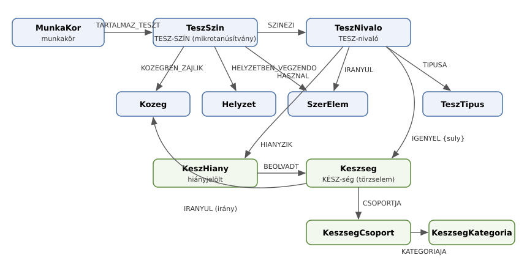

- `(MunkaKor)-[:TARTALMAZ_TESZT {alap_szin, kontextus_hu, szin_kulonbseg_hu, expected_eqf, frequency}]->(TeszSzin)`
- `(TeszSzin)-[:SZINEZI]->(TeszNivalo)`; `(TeszSzin)-[:KOZEGBEN_ZAJLIK {primary}]->(Kozeg)`,
  `-[:HELYZETBEN_VEGZENDO {primary}]->(Helyzet)`, `-[:HASZNAL]->(SzerElem)` (kísérő SZER-ELEM)
- `(TeszNivalo)-[:IRANYUL]->(SzerElem)` (meghatározó), `-[:TIPUSA]->(TeszTipus)`,
  `-[:IGENYEL {munkakorok, suly}]->(Keszseg)`, `-[:HIANYZIK]->(KeszHiany)`
- `(Keszseg)-[:CSOPORTJA]->(KeszsegCsoport)-[:KATEGORIAJA]->(KeszsegKategoria)`, `(Keszseg)-[:IRANYUL]->(Kozeg)`

A jelenlegi gráf (TOP10): 10 munkakör, 52 TESZ-nivaló, 87 TESZ-SZÍN, 110 SZER-ELEM, 293 KÉSZ-ség, 19 csoport,
5 kategória. A legtöbb munkakörben előforduló TESZ-nivalók: „Hiba feltárása és javítása” (6 munkakör), „Szakmai
egyeztetés lefolytatása” (6), „Műszaki dokumentáció és jelentés készítése” (5), „Felhasználók betanítása” (4).

## 2. Indítás és beállítás

### 2.1 A felület indítása

```bash
conda activate gaphopper
python -m gaphopper ui            # http://localhost:8765
```

Mindig a **gaphopper** conda-környezetből indítsd. A felület a háttérparancsokat ugyanazzal a Pythonnal indítja; ha a
base környezetből indul, hiányozni fog az `anthropic` csomag, és a futás az első LLM-hívásnál elbukik. A felület ezt
indításkor és minden parancs előtt ellenőrzi, és érthető hibát ad.

Kódfrissítés után a felületet újra kell indítani (Ctrl+C, majd újra `python -m gaphopper ui`). A felületről indított
parancsok mindig új folyamatban futnak, ezért azok a friss kódot használják.

### 2.2 Kulcsok és beállítások (.env)

A projekt gyökerében lévő `.env` fájl az egyetlen hely a kulcsoknak:

```bash
ANTHROPIC_API_KEY=sk-ant-...      # P1, P3, P5, kesz-bovit, kesz-irany, generalize
GEMINI_API_KEY=...                # P2 (bíráló), ha Geminin fut
NEO4J_URI=bolt://localhost:7687
NEO4J_USER=neo4j
NEO4J_PASSWORD=...
```

- **Ne legyen kulcs a `~/.bashrc`-ben.** A környezeti változó elsőbbséget élvez a `.env`-vel szemben; egy lejárt,
  exportált kulcs 401-es hibát okoz (2026-11-10-én a #73 jóváhagyása emiatt bukott el). A kód ilyenkor egyszer a
  `.env` kulcsával is megpróbálja, de a tiszta megoldás: `unset ANTHROPIC_API_KEY`, és csak a `.env`.
- **`ANTHROPIC_WORKSPACE_ID`**: csak akkor kell, ha a kulcs munkaterülethez kötött. Hibás értéknél 404 („Workspace not
  found”); a kód ilyenkor fejléc nélkül ismétel, de érdemes törölni.
- A kulcsot soha ne írd a `config/models.yaml`-ba.

### 2.3 Modellek (config/models.yaml)

Lépésenként szolgáltató és modell. A jelenlegi beállítás:

| Lépés | Szolgáltató | Modell | Feladat |
|---|---|---|---|
| E0 | openai-kompatibilis | shared-local | kinyerés dokumentumból |
| P1 | anthropic | claude-sonnet-5-5 | felbontás |
| P2 | gemini | gemini-3.6-flash | független bírálat |
| P3 | anthropic | claude-haiku-5-5 | egyesítés (és kesz-bovit, kesz-irany, generalize) |
| P4 | anthropic | claude-haiku-5-5 | KÉSZ-ség-horgonyzás |
| P5 | anthropic | claude-haiku-5-5 | tanúsítási szöveg, rubrika |

Ellenőrzés: `python -m gaphopper models` (az effektív értékek: models.yaml → .env → kódalapérték), vagy a
**Modellek** fül. A **Komponensek** fül a neo4j, az API-k és a beágyazás elérhetőségét mutatja.

### 2.4 Gyakori indítási hibák

| Tünet | Ok | Megoldás |
|---|---|---|
| „No module named 'anthropic'” a futás naplójában | a felület a base Pythonnal fut | `conda activate gaphopper`, majd újraindítás |
| 401 „invalid x-api-key” | lejárt vagy rossz kulcs, gyakran a `.bashrc`-ből | új kulcs a `.env`-be, `unset ANTHROPIC_API_KEY` |
| 404 „Workspace … not found” | hibás `ANTHROPIC_WORKSPACE_ID` | töröld a sort a `.env`-ből |
| „A neo4j nem érhető el” | a neo4j nem fut | Komponensek → „Neo4j Docker indítása” |
| A felületen nem látszik egy új funkció | régi szerverfolyamat fut | a felület újraindítása |

## 3. A feldolgozási lánc lépésenként

Egy munkakör útja: **(E0) → P1 → (P2) → P3 → gráf → P5**, a törzsek karbantartása: **P6 (generalize), split,
kesz-bovit, kesz-irany**. A P0 a közös rendszerprompt (fogalmak, kódok, próbák), minden lépés ezt kapja.

### 3.1 E0 – kinyerés dokumentumból

Álláshirdetésből, munkaköri leírásból (PDF, DOCX, TXT) munkakör-rekordot készít: cím, szakterület, feladatok,
követelmények. Csak a szövegben szereplő adatot gyűjti ki. Felület: **Feltöltés** fül. Parancs:
`python -m gaphopper extract <fájl|mappa> --out data/jobs.jsonl --import`.

### 3.2 P1 – felbontás TESZ-nivalókra és SZÍN-ekre

A munkakör-rekordból 6–12 TESZ-nivalót (ebből 4–9 CORE) és 8–18 TESZ-SZÍN-t készít. Először a **TESZ-törzsből**
választ (ha a típus, a SZER-ELEM fajtája és az ERED-mény azonos, és a szakember ráismer), és csak akkor alkot újat, ha
egyik sem illik. TESZ-nivalónként 2–5 KÉSZ-séget választ a KÉSZ-ség-törzsből, és ha valami lényeges hiányzik, legfeljebb
2 **hiányjelöltet** (`kesz_hiany`) ír. A rendszerprompt két gyorsítótárazott blokk: P0 + KÉSZ-ség-törzs (irány szerinti
fejlécek alatt), illetve a TESZ-törzs.

- Modell: Sonnet. Költség: kb. 0,06–0,08 USD munkakörönként (gyorsítótárral), 20–30 mp.
- Példa kimenet (Szoftverfejlesztő, egy TESZ-nivaló):
  - „Szoftver tesztelése” · ellenőriz (VERIFY) · ‹Szoftver› · CORE · kontextus: „egység- és rendszerteszt, MI-kimenet ellenőrzése”
  - ALAP-SZÍN: Digitális / Rutin, EQF 5

### 3.3 P2 – független bírálat

Ha a determinisztikus szabályok (R1–R21) jeleznek, vagy a munkakör a véletlen mintába esik, egy másik modell
(Gemini) bírálja a P1-et, és csak az eltéréseket adja vissza: FIX (javítás), DROP (törlés), MERGE/FOLD (összevonás),
MOVE, SPLIT, ADD (új elem). Ha a jelzések a javítás után is megmaradnak, a munkakör **szakértői jóváhagyásra** kerül.

- Példa (Okleveles ápoló): FIX „Munkatársak munkájának irányítása” ‹Feladat› → „Munkatársak és feladatok
  koordinálása” ‹Munkatárs›, mert a név nem tartalmazta a meghatározó SZER-ELEM-et (R21).
- Modell: Gemini Flash. Költség: kb. 0,015–0,02 USD.

### 3.4 P3 – egyesítés és gráfba írás

Eldönti, hogy a munkakör TESZ-nivalói és SZER-ELEM-jei azonosak-e a gráfban már meglévőkkel (SAME / NARROWER /
BROADER / NEW). A törzsből választott TESZ-nivalóknál nincs hívás. A SZÍN-egyezés determinisztikus: a TESZ-SZÍN
kiléte a ⟨TESZ-nivaló, KÖZ-eg, HELY-zet⟩. A gráfírás egy tranzakcióban történik; utána frissül a KÉSZ-ségek
2. tengelye (TESZ-típus-család, hordozhatóság). Bizonytalan egyesítésnél „Bizonytalan egyesítés” kérés jön létre.

- Modell: Haiku. Költség: kb. 0,002 USD.

### 3.5 P5 – tanúsítás (certify)

TESZ-nivalónként 3–6 alapkritériumot (rubrika), változatonként egy igazolási mondatot és 1–3 kiegészítő
SZÍN-kritériumot ír. Csak a még rubrika nélküli elemeket dolgozza fel.

Példa („Programkód írása és módosítása”):
- ERED-mény: „A kód a specifikáció szerint működik, olvasható, és a módosítás nem rontja a meglévő működést.”
- Alapkritériumok: „A kód a specifikációban rögzített bemenetekre a várt kimenetet adja.” · „A módosítás után a
  korábban működő funkciók változatlanul működnek, ezt ellenőrző teszttel igazolja.” · …
- „Digitális / Változó” igazolás: „A személy önállóan módosít programkódot digitális rendszerben, folyamatos
  alkalmazkodás közben, a működés megőrzésével és az új hardverhez vagy felülethez igazított eredménnyel.”
- Költség: kb. 0,02 USD a TOP10 teljes gráfjára (3 perc).

### 3.6 P6 – általánosítás (generalize) és bontás (split)

A több munkakörben, eltérő kontextussal használt TESZ-nivalókra eldönti: MARAD, ATNEVEZ (általánosabb név, a régi
alias marad), vagy BONT (gyűjtő-név, bontási javaslat a szakértői sorba). A jóváhagyott bontást a `split` hajtja
végre. Példa (korábbi kör): „Szoftver tesztelése” mellé a villanyszerelő és a villamosmérnök számára új
„Villamos áramkör vizsgálata” TESZ-nivaló jött létre.

### 3.7 kesz-bovit – a KÉSZ-ség-törzs bővítése

A P1 hiányjelöltjeit csoportosítja, és dönt: **ALIAS** (csak teljes jelentésfedésnél: egy meglévő törzselem más néven;
azonnal érvényes), **UJ** (hiányzó vagy csak részben fedett, törzsszintű KÉSZ-ség; a szakértői sorba kerül, ha legalább
2 munkakör igényli, különben vár), **ELVET** (szakmai tartalom: TUD-ás vagy SZER-ELEM). Példa: a gyógypedagógus és a
középiskolai tanár „Differenciált oktatás”, „Pedagógiai differenciálás” jelöltjeiből lett gh_c_292 „Egyéni
igényekhez igazítás”; a séf „Ízlésérzék” jelöltje után vettük fel a gh_c_293 „Ízérzékelés”-t.

### 3.8 kesz-irany – a KÉSZ-ség-irányok

Elemenként megvizsgálja, melyik KÖZ-egre irányul a KÉSZ-ség (1–2 irány). A biztos eltérést beírja, a bizonytalant
a KÉSZ-ség-sorba teszi. Példa: „Hipotézisvizsgálat” → Tudományos; „Szövegértés” → Nyelvi; „Stressztűrés” → egy-ÉN.

### 3.9 Próbafutás (dry run)

A P1–P3 lefut (tokenek, költség), de sem a gráf, sem a futási napló nem változik. Kimenet: `runs/dryrun/<munkakör>.json`.
Promptváltoztatás után mindig 3 munkakörön próbálj, mielőtt élesben futtatsz.

## 4. A felület fülei

### 4.1 Futás

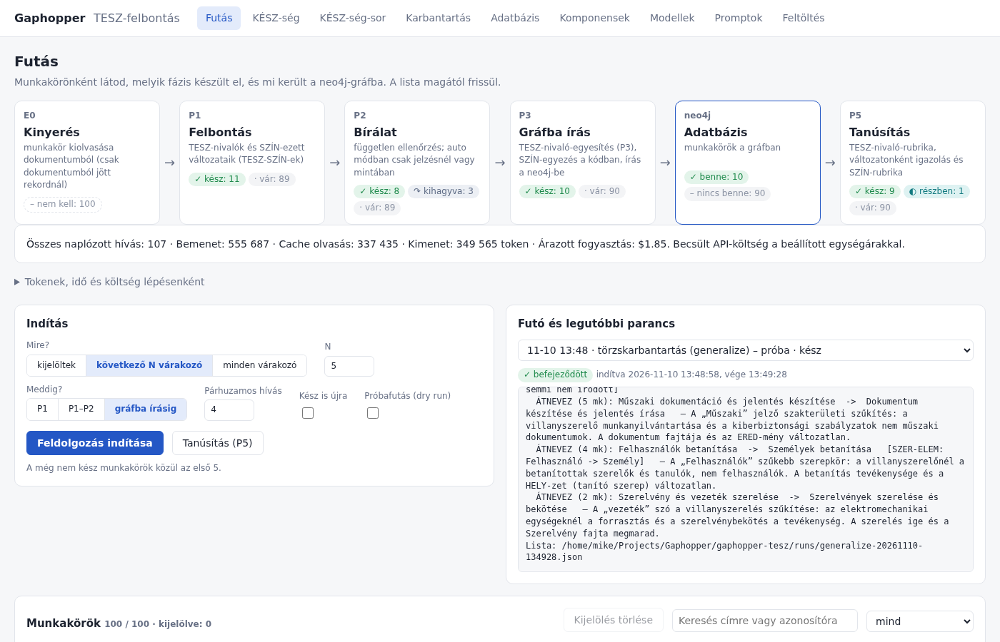

- **Fázissáv** felül: E0 kinyerés → P1 felbontás → P2 bírálat → P3 gráfba írás → neo4j → P5 tanúsítás; mindegyiknél
  hány munkakör kész, kihagyott, hibás, várakozó vagy fut.
- **Tokenek, idő és költség**: összesen és lépésenként.
- **Indítás**: kijelöltek / következő N / minden várakozó; meddig (P1, P1–P2, teljes); hány szálon; **Próbafutás (dry
  run)** kapcsoló; „újrafuttatás” (`--force`).
- **Futó és legutóbbi parancs**: a háttérparancs naplója élőben, leállítható.
- **Munkakör-lista**: munkakörönként a fázisok állapota és hogy ténylegesen benne van-e a gráfban.

Egy munkakörre kattintva megnyílik a **részletező panel**:

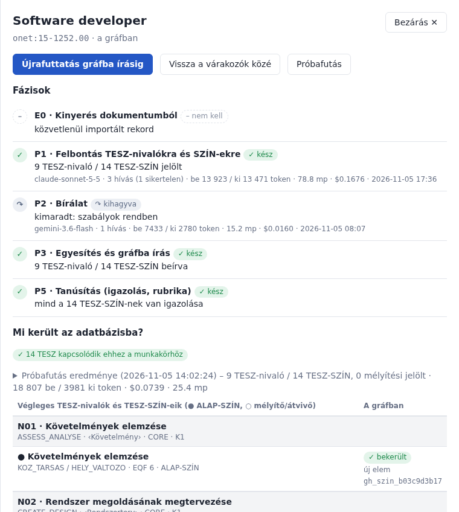

- fázisonként a modell, a tokenek, az idő, a költség és a hiba szövege;
- a P2 módosításai;
- TESZ-nivalónként a változatok (● ALAP-SZÍN, ○ mélyítő vagy átvivő, ◇ mélyítési jelölt), hogy bekerültek-e a gráfba;
- a próbafutás eredménye, benne a KÉSZ-ség-hiányjelöltekkel;
- a **szakértői döntés** kártyái (lásd 5. fejezet).

### 4.2 Szakértői döntés (a munkakör paneljén)

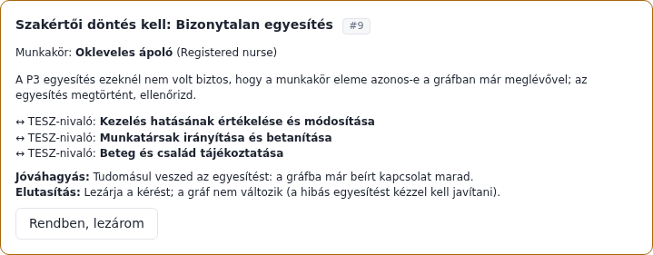

Minden kártyán: a munkakör magyar és angol neve; a jelzések szabálynévvel és egymondatos jelentéssel; az érintett
TESZ-nivalók teljes megnevezéssel (típus, meghatározó SZER-ELEM, KÉSZ-ségek, SZÍN-ek); összevonási jelöltnél a két elem
egymás mellett; a P2 javításai előtte/utána; „a mostani szabályok szerint már nem áll fenn” jelölés, ha a szabály
azóta javult; és hogy mit jelent a jóváhagyás és az elutasítás. Gombok:

- **Jóváhagyás és gráfba írás** (munkakör-jóváhagyás): `review --approve <id>`; a munkakör végleges TESZ-nivalói és
  TESZ-SZÍN-jei a gráfba kerülnek.
- **Elutasítás**: a munkakör nem kerül a gráfba; a P1/P2 eredménye megmarad.
- **Rendben, lezárom** (bizonytalan egyesítés): tudomásulvétel, a gráf nem változik.

### 4.3 KÉSZ-ség

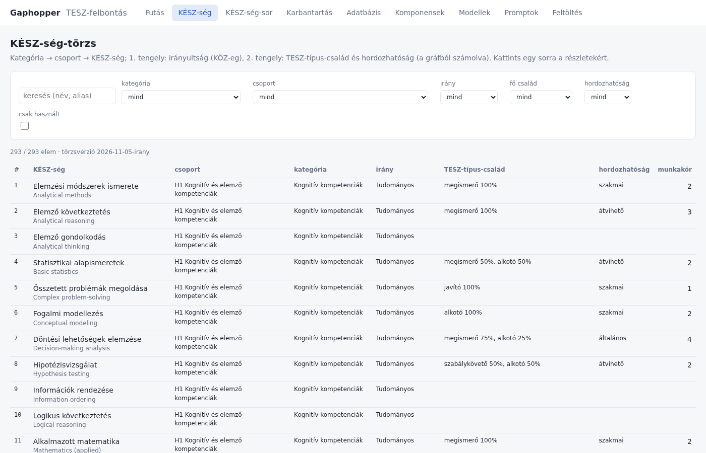

A 293 elemes törzs táblázatban: sorszám, név (magyar, angol), csoport, kategória, irány, TESZ-típus-család aránnyal,
hordozhatóság, hány munkakör igényli. Szűrők: keresés névre és aliasra, kategória, csoport, irány, fő család,
hordozhatóság, „csak használt”. Egy sorra kattintva:

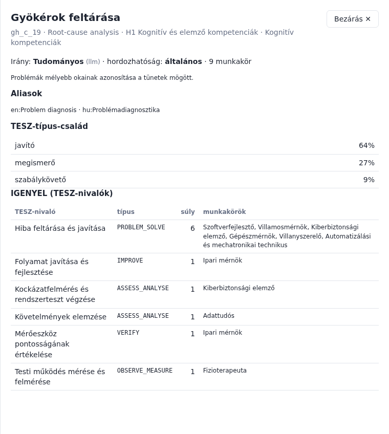

aliasok, leírás, családarányok, az **IGENYEL** élek (TESZ-nivaló, típus, súly = hány munkakör igényli, munkakörök) és a
beolvadt hiányjelöltek. A törzset minden megnyitáskor frissen olvassa a yaml-ból.

### 4.4 KÉSZ-ség-sor

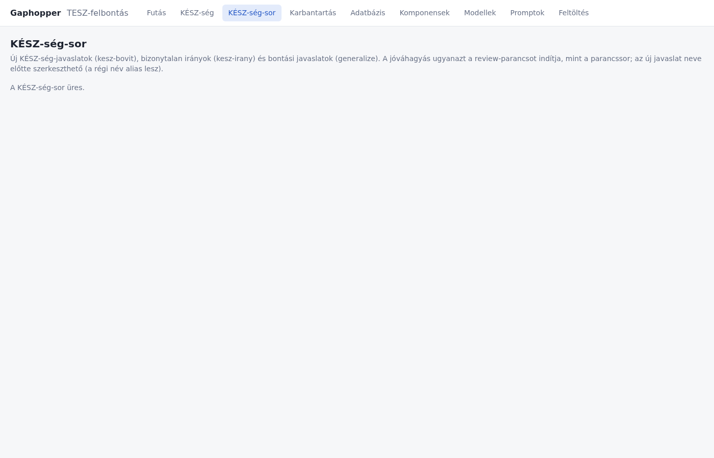

Itt vannak a nem munkakörhöz kötött szakértői kérések:

- **Új KÉSZ-ség** (kesz-bovit UJ): a magyar és angol név, a csoport és az irány jóváhagyás előtt szerkeszthető; a régi
  név alias lesz. Jóváhagyás: új gh_c szám a yaml-ban és a gráfban, IGENYEL élekkel.
- **KÉSZ-ség iránya** (kesz-irany): a KÉSZ-ség neve, csoportja, jelenlegi és javasolt irány, indoklás, az igénylő
  TESZ-nivalók. A javasolt irány a két legördülő menüben módosítható.
- **Bontási javaslat** (generalize BONT): jóváhagyás után a Karbantartás fülön a „split” hajtja végre.

### 4.5 Karbantartás

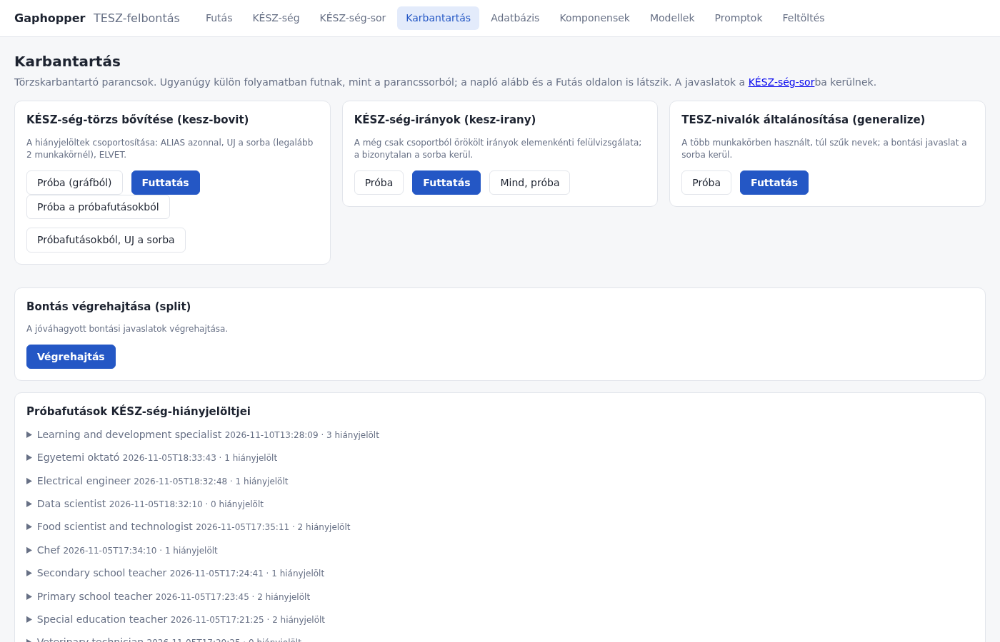

Gombok a karbantartó parancsokhoz (mind háttérfolyamatban, naplóval):

| Kártya | Gomb | Parancs | Mit ír |
|---|---|---|---|
| KÉSZ-ség-törzs bővítése | Próba (gráfból) | `kesz-bovit --dry-run` | semmit |
| | Futtatás | `kesz-bovit` | ALIAS: yaml + gráf; UJ: sor; ELVET: jelölt állapota |
| | Próba a próbafutásokból | `kesz-bovit --from-dryrun runs/dryrun/*.json` | semmit |
| | Próbafutásokból, UJ a sorba | `… --queue` | csak a sort |
| KÉSZ-ség-irányok | Próba / Futtatás / Mind, próba | `kesz-irany [--dry-run] [--all]` | yaml + gráf (IRANYUL), bizonytalan: sor |
| Általánosítás | Próba / Futtatás | `generalize [--dry-run]` | átnevezés (régi név alias), bontás: sor |
| Bontás | Végrehajtás | `split` | új TESZ-nivaló, munkakörök átkötése |

Alul a próbafutások KÉSZ-ség-hiányjelöltjei: név, csoport, irány, R23-állapot (törzsjelölt / TUD-ás-SZER-ELEM / már a
törzsben), TESZ-nivaló.

### 4.6 Adatbázis

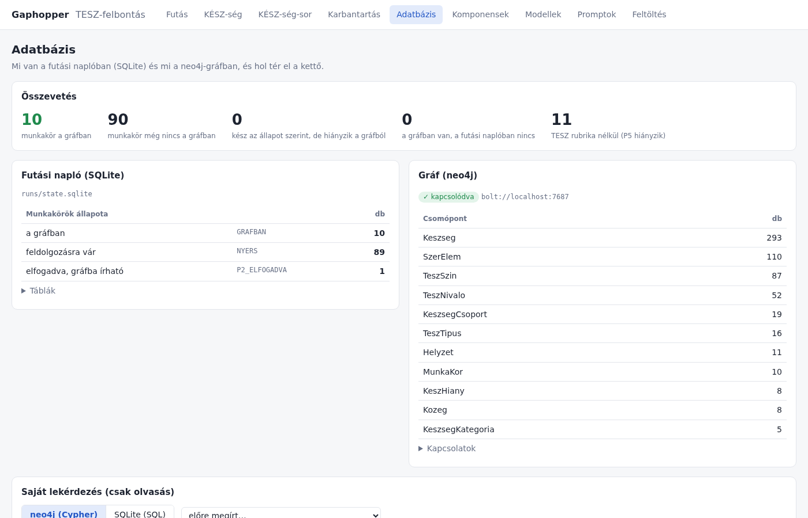

Összevetés a futási napló (SQLite) és a gráf (neo4j) között: hány munkakör van a gráfban, melyik „kész” hiányzik, mi
van csak a gráfban, hány TESZ-SZÍN-nek nincs rubrikája. Csak olvasó Cypher- és SQL-lekérdező, előre megírt
lekérdezésekkel (lásd 8.2).

### 4.7 Komponensek

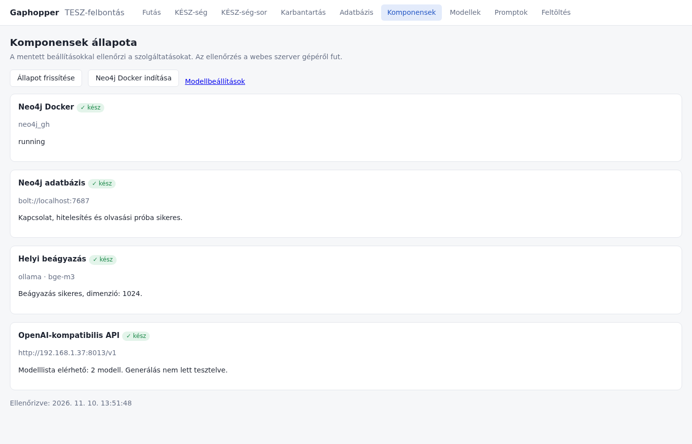

A neo4j, az API-szolgáltatók és a beágyazó modell elérhetősége; „Neo4j Docker indítása” gomb.

### 4.8 Modellek

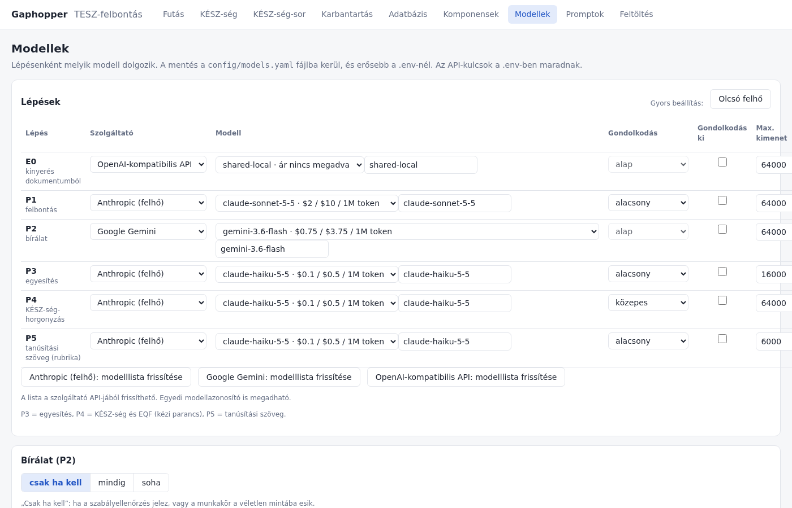

Lépésenként szolgáltató, modell, gondolkodási szint (effort), max_tokens; API-ból frissíthető modellválaszték;
OpenAI-kompatibilis API és beágyazás ellenőrzése; egységárak; P2-mód. A mentés a `config/models.yaml`-ba kerül.

### 4.9 Promptok

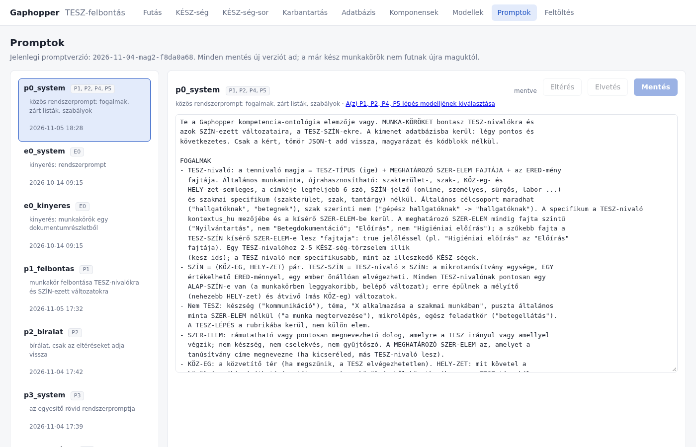

A promptfájlok a lépés sorrendjében; szerkesztés, eltérés mentés előtt, korábbi változatok. **Minden mentés új
promptverziót ad**; a kész munkakörök nem futnak újra maguktól. A P0 és a vocab.yaml változtatása szakmai döntés:
utána 3 munkakörös próbafutás kell.

### 4.10 Feltöltés

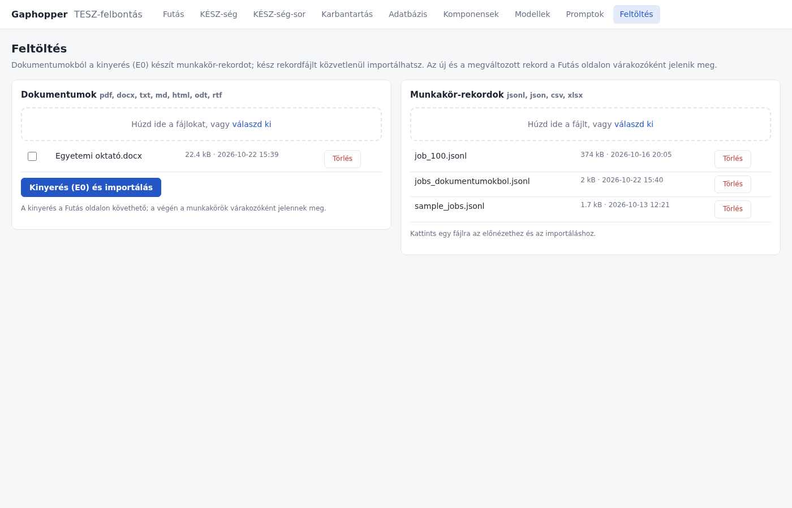

Dokumentumok behúzása és kinyerése (E0, utána import); kész rekordfájl (JSONL) előnézete (új / változott /
változatlan) és importja. Az új munkakörök a Futás fülön várakozóként jelennek meg.

### 4.11 Használati segéd

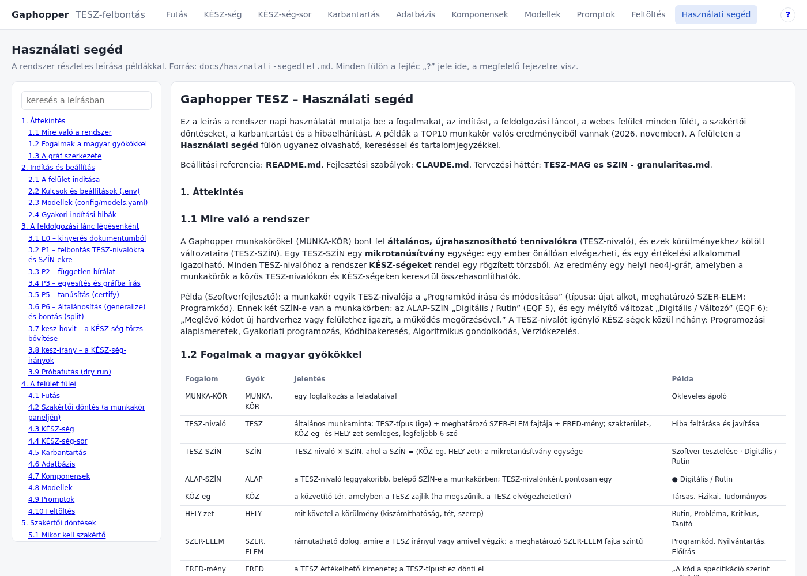

Ez a leírás, tartalomjegyzékkel és kereséssel (a keresés csak a találatot tartalmazó fejezeteket mutatja). Minden fül
fejlécében a „?” jel ennek a leírásnak a megfelelő fejezetére visz.

## 5. Szakértői döntések

### 5.1 Mikor kell szakértő

- **Munkakör jóváhagyása**: a P2 után is maradt szabályjelzés.
- **Bizonytalan egyesítés**: a P3 nem volt biztos egy TESZ-nivaló vagy SZER-ELEM azonosságában.
- **Új KÉSZ-ség**, **KÉSZ-ség iránya**, **Bontási javaslat**: a KÉSZ-ség-sorban.

### 5.2 A szabályok és próbák

<!-- szabalyok:start -->
| kód | név | jelentés |
|---|---|---|
| R1 | Darabszám-korlát | A TESZ-nivalók (6–12), a TESZ-SZÍN-ek (8–18) vagy a CORE TESZ-nivalók (4–9) száma a sávon kívül esik. |
| R4 | Címke formája | A TESZ-nivaló neve túl rövid vagy hosszú (2–6 szó), vagy tiltott címkemintát tartalmaz. |
| R5 | Túl sok végrehajtás | Az EXECUTE típusú TESZ-nivalók aránya a megengedettnél nagyobb. |
| R6 | Egyoldalú HELY-zet | Az ALAP-SZÍN-ek túlnyomó része a TESZ-típus természetes HELY-zet-párja. |
| R7 | Sok kritikus HELY-zet | A kritikus HELY-zetű változatok aránya a szakterülethez képest túl nagy. |
| R8 | Ismétlődő változat | Két változat azonos ⟨típus, SZER-ELEM, KÖZ-eg, HELY-zet⟩ négyessel. |
| R9 | Üres feladatkör | Van olyan feladatkör, amelyhez nem tartozik TESZ-nivaló. |
| R10 | Bizonytalan elem | A modell maga is bizonytalan (alacsony confidence): szakértő döntsön. |
| R11 | Kettős TESZ-nivaló | Két TESZ-nivaló azonos típussal és meghatározó SZER-ELEM-mel: valószínűleg egy TESZ-nivaló két SZÍN-e. |
| R12 | Túl sok változat | Egy TESZ-nivalónak háromnál több SZÍN-változata van. |
| R13 | Indokolatlan változat | A nem ALAP-SZÍN változat nem írja le, mitől más vagy nehezebb (M2). |
| R14 | SZÍN a névben | A TESZ-nivaló neve SZÍN-jelzőt tartalmaz (pl. online, sürgős); a név legyen KÖZ-eg- és HELY-zet-semleges. |
| R15 | ALAP-SZÍN hiánya | Egy TESZ-nivalónak nem pontosan egy ALAP-SZÍN-e van. |
| R16 | Csak KÖZ-egben eltérő változat | A változat csak a KÖZ-egben tér el, a kísérő SZER-ELEM-ek azonosak: inkább kísérő KÖZ-eg. |
| R17 | Szakterületi szó a névben | A munkakör saját címének vagy szakterületének szava a TESZ-nivaló nevében vagy SZER-ELEM-ében (G1). |
| R18 | Összevonási jelölt | Két TESZ-nivaló azonos típusú, és KÉSZ-ségeik legalább 2/3-a közös: lehet, hogy egy TESZ-nivaló (G4). |
| R19 | Kevés újrahasznosítás | Nagy TESZ-törzs mellett a munkakör TESZ-nivalóinak több mint fele új; ha illik, a törzsből kellene választani. |
| R20 | Kevés KÉSZ-ség | A TESZ-nivalóhoz kettőnél kevesebb KÉSZ-ség-törzselem tartozik (G2). |
| R21 | A név nem tartalmazza a meghatározó SZER-ELEM-et | A TESZ-nivaló nevéből nem ismerhető fel, mire irányul: hiányzik belőle a meghatározó SZER-ELEM neve vagy töve (G5). |
| R23 | Nem törzsszintű KÉSZ-ség-jelölt | A hiányjelölt neve szakmai, termék-, szint- vagy munkakör-specifikus: TUD-ás- vagy SZER-ELEM-jelölt. |
| G1 | Munkakör-csere próba | A TESZ-nivaló neve legalább 3 munkakörben előfordulhatna. |
| G2 | KÉSZ-ség-illeszthetőség | 2–5 törzselem közvetlenül illik a TESZ-nivalóhoz. |
| G3 | SZÍN-semlegesség | A változat címkéje azonos a TESZ-nivalóéval, a SZÍN csak a ⟨KÖZ-eg, HELY-zet⟩-ben jelenik meg. |
| G4 | Összevonás | Azonos típus, ERED-mény és nagy KÉSZ-ség-átfedés: egy TESZ-nivaló. |
| G5 | Felismerhetőségi próba | A szakember a névből ráismer a fő tevékenységére (alapige + meghatározó SZER-ELEM). |
| M1 | SZÍN-csere próba | Ha a KÖZ-eg vagy HELY-zet cseréjénél az ige, a SZER-ELEM és az ERED-mény marad, ugyanaz a TESZ-nivaló. |
| M2 | Rubrika-különbség | Külön változat csak új vagy szigorúbb értékelési kritériummal. |
| M3 | Előfordulás | Változat csak akkor, ha a munkakörben rendszeresen előfordul. |
<!-- szabalyok:end -->

A törzs-őr: ha a P1 a TESZ-törzsből választ, de a saját meghatározó SZER-ELEM-fajtája eltér a törzselemétől, az
egyesítés „torzs-ellenorzendo” jelölést kap, és átnézésre kerül.

### 5.3 Mit érdemes dönteni – példák

**#73 – Okleveles ápoló, R21 (téves jelzés).** Érintett: „Munkatársak és feladatok koordinálása” ‹Munkatárs›. A
jelzés oka egy szabályhiba volt (a „munkatárs” a munkakörcímek kizárólistáján szerepelt), a kártya ezt jelezte: „a
mostani szabályok szerint már nem áll fenn”. Döntés: **jóváhagyás**.

**#79 – Automatizálási és mechatronikai technikus, R18 (összevonási jelölt).** „Mérőeszköz pontosságának értékelése”
‹Mérőműszer› és „Alkatrész vizsgálata előírás szerint” ‹Alkatrész›: azonos típus (ellenőriz), közös KÉSZ-ség: Mérés és
kalibrálás, Pontos kivitelezés, Részletekre figyelés. A meghatározó SZER-ELEM eltér, ezért két külön TESZ-nivaló
helyes. Döntés: **jóváhagyás** (ha ugyanaz lenne a SZER-ELEM is, elutasítás, majd újrafuttatás összevonással).

**Iránykérdés – Kritikai gondolkodás.** Jelenlegi: egy-ÉN; javasolt: Tudományos („az információk és feltételezések
értékelése gondolati érvelésre irányul”). Döntés: Tudományos (2026-11-05). Hasonlóan: Műszaki rajzolás és CAD →
Digitális; Etikai alapelvek ismerete → Szervezeti.

Általános szempontok:
- Ha a jelzés a mostani szabályok szerint már nem áll fenn, jóváhagyható.
- R19 (kevés újrahasznosítás) önmagában nem ok az elutasításra; ha a TESZ-nivalók nevei jók, jóváhagyás, és a
  törzskarbantartás (generalize) később rendet tesz.
- R21/G5: ha a névből nem ismerhető fel a tevékenység, elutasítás és újrafuttatás (`--force`).
- Új KÉSZ-ségnél: törzsszintű-e (általános, 1–4 szó, nem eszköz, termék, szakterület vagy szint)? Ha egy meglévő
  elem teljesen fedi, elutasítás; a név szerkeszthető általánosabbra (pl. „Egyéni differenciálás” → „Egyéni
  igényekhez igazítás”).

## 6. Karbantartási kör

A karbantartó parancsok nem minden futás után kellenek, hanem ha új bizonyíték gyűlt össze (kb. 10–20 új
munkakörönként). A szokásos sorrend:

1. munkakörök feldolgozása (Futás);
2. a szakértői sor átnézése;
3. `generalize`: előbb próba, majd futtatás;
4. a bontási javaslatok jóváhagyása, majd `split`;
5. `kesz-bovit`, majd az új KÉSZ-ség-javaslatok jóváhagyása;
6. `kesz-irany`, ha új KÉSZ-ség került a törzsbe;
7. `certify` (P5).

Költség: egy-egy karbantartó parancs 0,001–0,02 USD (Haiku). A drága rész a P1 a munkakörönkénti feldolgozásban
(kb. 0,08–0,10 USD munkakörönként a teljes lánccal).

## 7. A KÉSZ-ség-törzs

- **Forrás**: GH_competency_list (gh_c_1–275) és a GH_competency_hierarchy_v3 (`data/competency/`); gh_c_276–291 a v3
  új elemei; gh_c_292 („Egyéni igényekhez igazítás”) és gh_c_293 („Ízérzékelés”) a bővítésből. Az azonosítók nem
  változnak. Fájl: `config/kesz_torzs.yaml` (soronként egy elem; a program is írja).
- **Hierarchia**: 5 kategória (Személyes, Társas, Vezetői, Kognitív, Szakmai-technikai) → 19 csoport (P1–P4, S1–S3,
  L1–L2, H1–H10) → elem.
- **Nincs típus**: a TUD-ás, KÉP-esség és HOZZÁ-állás egy TESZ-reKÉSZ-ség állapotai, nem fajták.
- **1. tengely – irány** (KÖZ-eg, 1–2 elemenként): jelenleg Digitális 63, Szervezeti 51, egy-ÉN 51, Társas 47,
  Tudományos 38, Fizikai 23, Nyelvi 19, Természet 1. Határesetek: „Fogalmi modellezés” → Tudományos (nem Digitális);
  „Tudományos írás” → Nyelvi; „Szakmai felelősség” → Szervezeti; „Ügyesség” → Fizikai.
- **2. tengely – TESZ-típus-család és hordozhatóság** (számolt, minden gráfírás után): a családok: megismerő, alkotó,
  végrehajtó, közlő, irányító, szolgáló, szabálykövető, javító. Hordozhatóság az igénylő munkakörök fő
  szakterületeinek száma szerint: 1 = szakmai, 2 = átvihető, legalább 3 = általános (most: 24 általános, 30 átvihető,
  76 szakmai). Példa: „Gyökérok feltárása”: javító 67%, megismerő 22%, irányító 11%, általános.
- **Bővítés szabályai**: törzsszint (általános, szakterület-semleges, 1–4 szó; nem eszköz, termék, szoftver,
  szabvány, munkakör vagy szintváltozat); R23-őr a nem törzsszintű nevekre; UJ csak legalább 2 munkakörnél; ALIAS
  csak teljes jelentésfedésnél; az általános érzékszervi és testi képesség (ízlelés, szaglás, színlátás) törzsszintű
  (H10, Fizikai), a neve az érzékre utal, nem a szakmára.

## 8. Kimenetek

### 8.1 A mátrix (runs/top10_matrix.xlsx)

Létrehozás: `PYTHONPATH=. python runs/export_top10.py $(sed 's/--job //g' runs/top10_jobs.txt)`. Lapok:

- **Összefoglaló**: munkakörönként állapot, TESZ-nivaló- és TESZ-SZÍN-szám, törzsből választott arány, P3 kétes esetek.
- **Munkakör × TESZ-nivaló**: soronként egy TESZ-nivaló, oszloponként a munkakörök SZÍN-jei (● ALAP, ○ változat);
  KÉSZ-ség-csoport, -irány, -család és hordozhatóság összesítve.
- **TESZ-nivalók**: típus, meghatározó SZER-ELEM, SZÍN-ek, KÉSZ-ségek súllyal, kontextusok, rubrika.
- **KÉSZ-ség-csoportok**: csoportonként, irányonként és hordozhatóság szerint hány KÉSZ-ség-él munkakörönként.
- **KÉSZ-ségek**: a használt elemek hierarchiával, iránnyal, családaránnyal, hordozhatósággal.
- **Tokenek és költség**: munkakörönként és lépésenként.

### 8.2 Hasznos Cypher-lekérdezések (Adatbázis fül)

```cypher
// egy munkakör TESZ-SZÍN-jei
MATCH (m:MunkaKor {label_hu: 'Szoftverfejlesztő'})-[r:TARTALMAZ_TESZT]->(t:TeszSzin)-[:SZINEZI]->(n:TeszNivalo)
RETURN n.label_hu AS tesz_nivalo, t.szin AS szin, r.alap_szin AS alap, r.expected_eqf AS eqf ORDER BY tesz_nivalo
```

```cypher
// a legtöbb munkakörben előforduló TESZ-nivalók
MATCH (n:TeszNivalo)<-[:SZINEZI]-(:TeszSzin)<-[:TARTALMAZ_TESZT]-(m:MunkaKor)
RETURN n.label_hu AS tesz_nivalo, count(DISTINCT m) AS munkakor ORDER BY munkakor DESC LIMIT 15
```

```cypher
// két munkakör közös TESZ-nivalói
MATCH (a:MunkaKor {label_hu: 'Villamosmérnök'})-[:TARTALMAZ_TESZT]->(:TeszSzin)-[:SZINEZI]->(n:TeszNivalo),
      (b:MunkaKor {label_hu: 'Villanyszerelő'})-[:TARTALMAZ_TESZT]->(:TeszSzin)-[:SZINEZI]->(n)
RETURN DISTINCT n.label_hu
```

```cypher
// egy KÉSZ-ség igénylői súllyal
MATCH (n:TeszNivalo)-[e:IGENYEL]->(k:Keszseg {label_hu: 'Gyökérok feltárása'})
RETURN n.label_hu, e.suly, e.munkakorok ORDER BY e.suly DESC
```

```cypher
// SZÍN-ek KÖZ-eg szerint
MATCH (:MunkaKor)-[:TARTALMAZ_TESZT]->(t:TeszSzin)-[:KOZEGBEN_ZAJLIK {primary: true}]->(k:Kozeg)
RETURN k.label_hu AS kozeg, count(*) AS db ORDER BY db DESC
```

```cypher
// általános hordozhatóságú KÉSZ-ségek irány szerint
MATCH (k:Keszseg {hordozhatosag: 'altalanos'})-[:IRANYUL {primary: true}]->(z:Kozeg)
RETURN z.label_hu AS irany, collect(k.label_hu) AS keszsegek
```

```cypher
// mélyítési létra: egy TESZ-nivaló SZÍN-jei HELY-zet szerint
MATCH (n:TeszNivalo {label_hu: 'Hiba feltárása és javítása'})<-[:SZINEZI]-(t:TeszSzin)-[:HELYZETBEN_VEGZENDO {primary: true}]->(h:Helyzet)
RETURN t.szin, h.fok ORDER BY h.fok
```

```cypher
// nyitott KÉSZ-ség-hiányjelöltek
MATCH (n:TeszNivalo)-[e:HIANYZIK]->(h:KeszHiany {status: 'JELOLT'})
RETURN h.label_hu, h.csoport, e.munkakorok, n.label_hu
```

## 9. Parancssori referencia

Minden parancs: `python -m gaphopper <parancs>` a gaphopper környezetből.

| Parancs | Mit csinál | Példa |
|---|---|---|
| `init` | séma, szótárak, KÉSZ-ség-törzs a gráfba | `init` |
| `extract` | E0: dokumentumokból rekord | `extract docs/hirdetesek --out data/jobs.jsonl --import` |
| `import` | rekordfájl beolvasása | `import data/job_100.jsonl` |
| `run` | feldolgozás | `run --job onet:15-1252.00`; `--until p1|p2`; `--force`; `--workers 4` |
| `run --dry-run` | próbafutás, semmi nem íródik | `run --dry-run --job onet:35-1011.00 --input data/job_100.jsonl` |
| `show` | egy munkakör köztes eredményei | `show --job onet:29-1141.00` |
| `review` | szakértői sor magyarázattal | `review`; `review --approve 73`; `review --reject 73` |
| `certify` | P5 tanúsítás | `certify` |
| `generalize` | P6 általánosítás | `generalize --dry-run` |
| `split` | jóváhagyott bontás végrehajtása | `split` vagy `split --review 12` |
| `kesz-bovit` | KÉSZ-ség-törzs bővítése | `kesz-bovit --dry-run`; `kesz-bovit --from-dryrun runs/dryrun/*.json --queue` |
| `kesz-irany` | KÉSZ-ség-irányok | `kesz-irany`; `--all`; `--irany KOZ_DIGITALIS`; `--csoport H1 --alapbol`; `--review-queue 23-40` |
| `db-reset` | mentés, majd ürítés | `db-reset --yes --graph-only` (csak a gráf), utána `init` |
| `stats`, `anchors`, `p4a` | statisztika, horgonyok, KÉSZ-ség-horgonyzás | `stats` |
| `report` | tokenek és költség promptverziónként | `report` |
| `models` | érvényes modellbeállítás | `models` |
| `embed` | beágyazás ellenőrzése, pótlása | `embed check` |
| `ui` | webes felület | `ui --port 8765` |

Tesztek: `python -m pytest -q`.

## 10. GYIK és hibaelhárítás

**Megnyomtam a jóváhagyást, de a kérés nem zárul le.** Nézd meg a Futás fülön a „Futó és legutóbbi parancs”
naplóját. Leggyakoribb ok: rossz API-kulcs (401) vagy rossz Python-környezet. Lásd 2.4.

**Kell-e újraindítani a felületet?** Kódfrissítés után igen. A felületről indított parancsok a friss kódot
használják, de maguk az oldalak (a felület kódja) csak újraindítás után frissülnek.

**Mi a különbség a próbafutás és a valódi futás között?** A próbafutás ugyanazokat az LLM-hívásokat végzi (költsége
van), de semmit nem ír a gráfba és a futási naplóba.

**Miért van egy munkakör „P2_ELFOGADVA” állapotban, de nincs a gráfban?** Gráf-újraépítés (`db-reset --graph-only`)
után. `run --job <id>` csak a P3-at futtatja (a régi P1/P2-vel), `--force`-szal újra a teljes láncot.

**Mikor kell újrafuttatni a TOP10-et?** Ha a szótár (vocab.yaml) vagy a P0 megváltozik (pl. új KÖZ-eg), mert a
TESZ-SZÍN-ek kiléte függ tőle. A KÉSZ-ség-törzs bővítése és az irányok változása nem igényel újrafuttatást.

**Miért kevés a KÉSZ-ség-hiányjelölt?** A 293 elemes törzs a legtöbb munkakört lefedi; a P1 csak akkor ír
hiányjelöltet, ha a legjobb törzselem is csak részben fed. Új szakterületeken (séf, pedagógus) több jelölt jön.

**Hol vannak a mentések?** `runs/backup-<dátum>/` (state.sqlite másolat és neo4j-export), minden `db-reset` előtt.

**Hol látom egy parancs kimenetét később?** `runs/ui_tasks/` (a felületről indított parancsok naplói).
